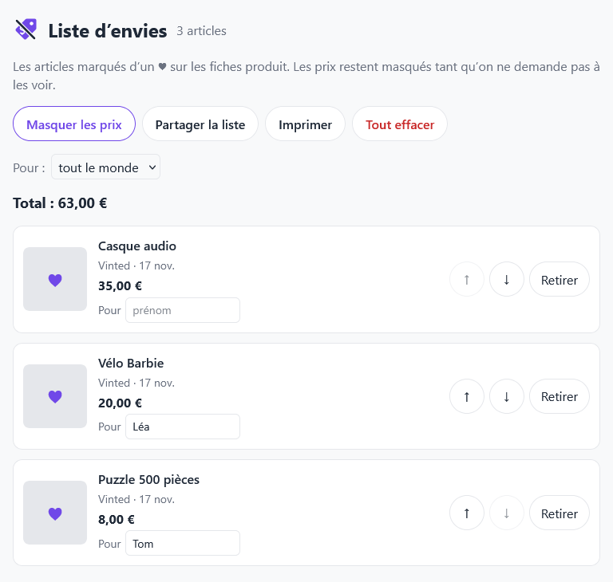

# Sans prix

Extension Firefox qui **masque les prix sur les grandes boutiques en ligne** —
Amazon, Fnac, Cdiscount, Darty, Boulanger, LDLC, E.Leclerc, Carrefour, Auchan,
eBay, AliExpress, Zalando… —, sur les **petites annonces** et l'**occasion** —
Leboncoin, Vinted, Back Market, Facebook Marketplace, Kleinanzeigen, Subito,
Discogs, Chrono24… — et sur **Google** (produits sponsorisés de la recherche et
de Google Images), pour laisser un enfant parcourir des idées de cadeaux sans
lui donner la notion de prix.

## Pourquoi

À l'approche de Noël ou d'un anniversaire, le plus sûr moyen de savoir ce qui
ferait plaisir à un enfant, c'est de le laisser parcourir les boutiques en
ligne et de le regarder faire : ce qu'il ouvre, ce sur quoi il s'attarde, ce
qu'il montre du doigt. Mais les prix sont partout, et ils changent la
conversation :

- l'enfant **se censure** (« celui-là, c'est trop cher ») ou, à l'inverse, vise
  le plus cher en le croyant le meilleur ;
- il **compare** : « mon frère a eu un cadeau à 80 €, moi à 30 € » ;
- le **budget**, qui est l'affaire des parents, devient un sujet de discussion.

Sans les prix, il choisit sur ce que l'objet est — photos, description, avis —
et la question du montant reste entre adultes. Une fois l'enfant parti,
<kbd>Alt</kbd>+<kbd>Maj</kbd>+<kbd>P</kbd> fait revenir les prix pour faire les
comptes.

Le masquage s'applique **avant** que la page ne s'affiche : aucun prix ne
clignote au chargement, pas même une fraction de seconde. Seules les remises en
pourcentage (« -50 % ») restent visibles — voir
[Ce qui est masqué](#ce-qui-est-masqué).

Le même principe sert à qui veut comparer des produits sans se laisser guider
par leur prix.

## En pratique

Les prix sont remplacés par une **barre grise** — translucide, elle se voit sur
un site clair comme sur un site sombre —, **floutés**, ou recouverts de
**papier cadeau** (rayures rose et jaune), au choix. Un interrupteur dans le
popup, ou <kbd>Alt</kbd>+<kbd>Maj</kbd>+<kbd>P</kbd>, les fait revenir dans tous
les onglets à la fois ; une pastille « off » sur l'icône rappelle qu'ils sont
visibles.

- **Pause** de 5 minutes, 15 minutes ou une heure : le temps de jeter un œil,
  puis le masquage revient seul, sans qu'on ait à y penser.
- **Ce site** : sur une page couverte, un second interrupteur éteint le
  masquage pour ce site seulement ; la liste repliée « Active sur 37 sites »
  fait de même site par site.
- **Code parent** (4 à 8 chiffres) : demandé pour tout ce qui **dévoile** les
  prix — couper le masquage, le mettre en pause, éteindre un site, afficher les
  prix de la liste d'envies, la vider, changer ou retirer le code. Rallumer ne
  le demande jamais. Avec un code, le raccourci clavier ouvre le popup au lieu
  de couper. C'est une porte fermée à un enfant curieux, pas un coffre-fort :
  qui ouvre `about:addons` peut désinstaller l'extension — sauf si elle est
  imposée par la stratégie du paquet (`policies.json`, ci-dessous).
- **Compteur** : le nombre de prix masqués sur la page, sur l'icône, onglet par
  onglet (« 99+ » au-delà). Il se coupe dans le popup.

À l'installation, puis après une mise à jour qui ajoute des sites ou change de
version mineure, une page **Quoi de neuf** s'ouvre : les sites à autoriser d'un
grand bouton, ce que la version change, le code parent à poser.


_Extension indépendante : ni éditée ni approuvée par les sites qu'elle couvre._

## La liste d'envies

Sur une fiche produit, un bouton **♥ Ma liste** permet à l'enfant de marquer ce
qui lui plaît, sans jamais y voir de prix. Le parent retrouve la liste depuis le
popup (**Voir la liste**) : image, titre, boutique, lien vers la fiche.

Les prix y sont **masqués à l'ouverture**, comme sur les boutiques : l'enfant
peut ouvrir la liste sans rien dévoiler. **Afficher les prix** les montre (code
parent demandé s'il y en a un), avec le **total** par devise, le temps de la
visite. **Partager la liste** passe par le partage du système sur Android, par
le presse-papiers ailleurs, et reprend ce qui est à l'écran : sans les prix tant
qu'ils sont masqués.

Pour une famille de plusieurs enfants :

- chaque article peut porter un **prénom** (« Pour Léa »), proposé parmi ceux
  déjà saisis ;
- **↑ ↓** rangent la liste dans l'ordre qu'on veut — un nouveau ♥ sur la même
  fiche met titre et prix à jour sans défaire ce rangement ;
- **Pour :** filtre la liste sur un enfant, total compris ;
- **Imprimer** sort la liste sans les boutons, prénoms en clair, prix masqués
  tant qu'on ne les a pas montrés.



L'extension reconnaît une fiche à ses données structurées — JSON-LD
`Product`, microdonnées, Open Graph — que la plupart des boutiques publient pour
les moteurs de recherche ; pour Amazon et Rue du Commerce, qui n'en publient
pas, la règle du site indique où lire titre, prix et image (`fiche`). Le bouton
se désactive dans le popup.

## Langues

L'extension parle **quinze langues** et suit celle de Firefox (le français par
défaut) : popup, liste d'envies, page des nouveautés, bouton ♥ sur les fiches,
nom et description dans le gestionnaire des modules.

| Priorité | Langues |
| -------- | ------- |
| P1 | français (`fr`), anglais (`en`), espagnol (`es`), allemand (`de`), italien (`it`), portugais (`pt`) |
| P2 | néerlandais (`nl`), polonais (`pl`), chinois simplifié (`zh_CN`), japonais (`ja`) |
| P3 | arabe (`ar`), coréen (`ko`), turc (`tr`), hindi (`hi`), russe (`ru`) |

L'**arabe** se lit de droite à gauche : les pages de l'extension prennent le
sens que Firefox donne à la langue (`@@bidi_dir`), et leur feuille n'emploie
que des propriétés logiques. Les dates, les nombres, les listes et les montants
de la liste d'envies suivent la langue (clé `langue`, une étiquette BCP 47 que
lit `Intl`).

Les traductions autres que le français et l'anglais n'ont pas encore été
relues par une personne de langue maternelle : une correction est la bienvenue
(un fichier, `extension/_locales/<langue>/messages.json`).
`npm test` vérifie que chaque langue a toutes les clés, garde ses marques
(`$NOMBRE$`…) et tient dans les limites du nom et de la description.

## Installer

Firefox 140 ou plus récent.

| Façon                   | Durée                                 | Ce qu'il faut                                                                                                                |
| ----------------------- | ------------------------------------- | ---------------------------------------------------------------------------------------------------------------------------- |
| **Depuis addons.mozilla.org** | définitive, mises à jour automatiques | [page de l'extension](https://addons.mozilla.org/firefox/addon/mister-no-price@mister-guiiug/) → _Ajouter à Firefox_ |
| **Depuis les releases** | définitive, mises à jour automatiques | ouvrir le `.xpi` de la [dernière release](https://github.com/mister-guiiug/mister-no-prices/releases/latest) dans Firefox     |
| **Temporaire**          | jusqu'au redémarrage                  | `about:debugging#/runtime/this-firefox` → _Charger un module complémentaire temporaire…_ → choisir `extension/manifest.json` |
| **Essai en un geste**   | le temps de la session                | `npm install` puis `npm start` : ouvre Firefox sur amazon.fr, extension chargée, rechargée à chaque modification             |

Depuis la 1.8.0, l'extension est **publiée sur le catalogue
d'addons.mozilla.org**. Chaque release porte le même `.xpi`, signé par Mozilla
une fois la version approuvée. Firefox refuse d'installer durablement une
extension non signée, sauf dans Developer Edition ou Nightly avec
`xpinstall.signatures.required` à `false`.

Une fois installée, d'où qu'elle vienne, l'extension **se met à jour seule**
depuis addons.mozilla.org, que Firefox consulte une fois par jour (ou à la
demande : `about:addons` → roue dentée → _Rechercher des mises à jour_). Les
copies installées depuis les releases jusqu'à la 1.7.0 déclaraient un
`update_url` vers le `updates.json` de la dernière release : c'est par lui
qu'elles passent à la version du catalogue, puis au catalogue.

### Sur Android

Firefox pour Android 142 ou plus récent. Le masquage, le popup (menu **⋮ →
Extensions → Sans prix**) et la liste d'envies y fonctionnent ; le popup s'y
ouvre en plein écran, avec des cibles à la taille du doigt. Il n'y a pas de
raccourci clavier : l'interrupteur du popup le remplace.

Le plus simple : ouvrir la [page de l'extension](https://addons.mozilla.org/firefox/addon/mister-no-price@mister-guiiug/) dans Firefox pour
Android → _Ajouter à Firefox_. Un `.xpi` de release s'installe aussi, par le
menu de débogage : **Paramètres → À propos de Firefox**, toucher cinq fois le
logo, puis **Paramètres → Installer une extension depuis un fichier**. Pour
essayer depuis un poste de développement, téléphone branché en USB et débogage
USB activé :

```bash
npx web-ext run --source-dir extension -t firefox-android --android-device <identifiant adb>
```

### Déployer à la main : le paquet

`npm run paquet` prépare, dans `web-ext-artifacts/mister-no-prices-<version>/`,
de quoi installer l'extension sur un poste sans rien savoir de ce dépôt :

| Fichier                          | Rôle                                                                     |
| -------------------------------- | ------------------------------------------------------------------------ |
| `mister-no-prices-<version>.xpi`  | l'extension signée par Mozilla — seulement avec des clés d'API (ci-dessous) |
| `mister-no-prices-<version>.zip`  | l'extension non signée                                                   |
| `INSTALLER.md`                   | les façons d'installer, pas à pas, pour qui n'est pas développeur        |
| `policies.json`                  | stratégie Firefox qui **impose** l'extension sur un ordinateur familial  |
| `SHA256SUMS`                     | empreintes, pour `sha256sum -c`                                          |

Le guide et la stratégie viennent de [`deploiement/`](deploiement/), remplis à
la version et à l'identifiant du manifeste.

Avec des clés d'API
([page des clés](https://addons.mozilla.org/developers/addon/api/key/)) dans
`WEB_EXT_API_KEY` et `WEB_EXT_API_SECRET` — dans l'environnement ou dans un
fichier `.env` à la racine du dépôt, ignoré par git —, le paquet **soumet la
version au catalogue** d'addons.mozilla.org et ne prend le `.xpi` qu'une fois
la version approuvée : c'est le geste de publication, pas un essai. Sans elles,
le paquet sort sans `.xpi` et le dit. Mozilla n'accepte qu'une fois un numéro
de version, tous canaux confondus.

### Publier une version

La publication est **automatique** : monter `version` dans
[`manifest.json`](extension/manifest.json) et `package.json` (les tests les
gardent alignés), fusionner la PR — c'est tout.
[`publication.yml`](.github/workflows/publication.yml), à chaque poussée sur
`main` et toutes les trois heures, regarde si la release `v<version>` existe ;
sinon il teste, puis **soumet** la version au catalogue d'addons.mozilla.org,
avec la fiche de [`amo/fiche.json`](amo/fiche.json) (description, catégorie,
licence). Mozilla la relit — souvent en quelques minutes, parfois en quelques
jours — puis la signe et la publie. Tant qu'elle est en relecture, le passage
s'arrête en vert, sans release ; le passage planifié suivant la retrouve sur
AMO, sans la soumettre une seconde fois. Une fois la version publiée, la
release suit, étiquette posée sur le commit, avec le `.xpi`, le paquet complet
et `updates.json`. Les installations existantes la reçoivent d'elles-mêmes.
Une PR qui ne change pas de version ne publie rien.

La **fiche** est tenue par le dépôt, et
[`fiche-amo.yml`](.github/workflows/fiche-amo.yml) la remet d'aplomb quand ses
sources changent sur `main`, et chaque jour : AMO ne lit le nom et le résumé du
manifeste qu'à la création de la fiche, et jamais son icône.

| Sur la fiche | Vient de |
| ------------ | -------- |
| nom, résumé | `extName`, `extDescription` de chaque langue de l'extension que la fiche propose |
| description, catégorie | [`amo/fiche.json`](amo/fiche.json), une description par langue, en Markdown limité (`**gras**`, listes en `- `, liens `[texte](adresse)`) : AMO affiche le HTML tel quel |
| page d'accueil | `homepage_url` du manifeste |
| icône | `extension/icons/icone-128.png` |
| captures d'écran | [`amo/captures.json`](amo/captures.json) (ordre, légendes dans chaque langue de la fiche) et `amo/captures/` (PNG de 1280 × 800) |

La fiche parle treize des quinze langues : AMO ne propose ni l'arabe ni
l'hindi pour le texte d'une fiche. L'espagnol, le portugais et l'anglais sont
recopiés vers leurs variantes régionales (`es-MX`, `pt-BR`, `en-GB`…), sans quoi
leurs visiteurs verraient le français, langue par défaut de la fiche. La
correspondance est `LANGUES_AMO`, dans [`scripts/fiche-amo.mjs`](scripts/fiche-amo.mjs).

Une capture est reconnue par sa légende française : relancer ne double rien,
et une capture ajoutée à la main sur la fiche n'est jamais supprimée. AMO
efface une légende posée juste après l'envoi de l'image : le script attend une
minute, pose la légende et vérifie qu'elle a tenu. AMO limite aussi le débit
(une demi-heure d'attente après quelques images) : le passage s'arrête alors en
vert, et le suivant reprend. Les deux captures d'Amazon ont l'adresse de livraison floutée
: à refaire pour toute nouvelle capture d'un site où l'on a une adresse.

La signature demande les secrets `AMO_API_KEY` et `AMO_API_SECRET` du dépôt ;
sans eux, le workflow échoue plutôt que de publier une release sans fichier
installable. Mozilla n'accepte qu'**une fois** un numéro de version : si la
release échoue après la signature, relancer le workflow — il retrouve la
version sur AMO et retélécharge le fichier signé, sans rien soumettre.

L'identifiant `mister-no-price@mister-guiiug` est figé par la première
signature : le changer ferait de la version suivante une autre extension, sans
ses réglages ni sa liste d'envies. Il garde donc le nom d'avant le renommage du
dépôt en `mister-no-prices`.

La 1.3.0 a été publiée sous l'ancien nom du dépôt : les copies qui l'ont
installée lisent leurs mises à jour à `github.com/mister-guiiug/mister-no-price/…`,
que GitHub redirige vers le nouveau nom. **Ne jamais recréer de dépôt
`mister-no-price`** : il prendrait la place de la redirection, et ces copies ne
se mettraient plus à jour. La version suivante, une fois installée, lit la
nouvelle adresse.

### Après une mise à jour : un « ! » sur l'icône

Firefox accorde les accès d'une extension **à son installation**, pas ceux
qu'une mise à jour ajoute. Une version qui gagne des sites n'y agit donc pas
tant qu'on n'a pas dit oui. Un clic sur l'icône la lance pour la page ouverte,
mais les prix réapparaissent à la page suivante.

L'icône porte alors une pastille **« ! »**. Ouvrir le popup : un encart nomme
les sites concernés — ou en donne le nombre, avec « Voir lesquels », quand une
version en ajoute beaucoup (la 1.4.0 en ajoute vingt) ; **« Autoriser »** les
accorde tous, une fois pour toutes.
Le même réglage existe site par site dans le menu des extensions de Firefox
(l'icône en forme de pièce de puzzle).

## Ce qui est masqué

| Site                | Domaines couverts                    | Prix masqués (bureau)                                   | Bouton ♥               | Site mobile         |
| ------------------- | ------------------------------------ | ------------------------------------------------------- | ---------------------- | ------------------- |
| **Amazon**          | 23 boutiques                         | ✔ amazon.fr, .com, .co.uk, .de, .es, .it                | ✔ les six              | ✔ amazon.fr, .com   |
| **AliExpress**      | aliexpress.com                       | ✔                                                       | ✔                      | non vérifié (délai) |
| **Auchan**          | auchan.fr                            | ✔                                                       | ✔                      | ✔                   |
| **Boulanger**       | boulanger.com                        | ✔                                                       | ✔                      | ✔                   |
| **Cdiscount**       | cdiscount.com                        | ✔                                                       | ✔                      | ✔                   |
| **Dealabs**         | dealabs.com                          | ✔                                                       | — pas de fiche produit | ✔                   |
| **Decathlon**       | 11 pays                              | ✔ decathlon.fr                                          | ✔                      | ✔                   |
| **E.Leclerc**       | e.leclerc, leclerc.fr                | ✔                                                       | ✔                      | ✔                   |
| **eBay**            | ebay.fr, ebay.com                    | ✔ les deux                                              | ✔ les deux             | ✔ ebay.fr           |
| **LDLC**            | ldlc.com                             | ✔                                                       | ✔                      | ✔                   |
| **Rue du Commerce** | rueducommerce.fr                     | ✔                                                       | ✔                      | ✔                   |
| **Zalando**         | zalando.fr                           | ✔ (générique seul)                                      | ✔                      | ✔                   |
| **Fnac**            | fnac.com                             | ✘ anti-robot ; règle tirée de la liste, vue une fois    | règle non vérifiée     | ✘ anti-robot        |
| **Darty**           | darty.com                            | ✘ anti-robot ; générique seul                           | ✘                      | ✘                   |
| **Carrefour**       | carrefour.fr                         | ✘ anti-robot ; générique seul                           | ✘                      | ✘                   |
| **ManoMano**        | manomano.fr                          | ✘ anti-robot ; générique seul                           | ✘                      | ✘                   |
| **Google**          | www.google.fr, .com, .be, .ch, … (9) | ◐ recherche et Images, voir ci-dessous                  | — pas de fiche produit | ✘ anti-robot        |

Petites annonces et occasion :

| Site                     | Domaines couverts                  | Prix masqués (bureau)                    | Bouton ♥                   | Site mobile |
| ------------------------ | ---------------------------------- | ---------------------------------------- | -------------------------- | ----------- |
| **Catawiki**             | catawiki.com                       | ✔                                        | ✔                          | ✔           |
| **Cash Express**         | cashexpress.fr                     | ✔                                        | ✔                          | ✔           |
| **Craigslist**           | craigslist.org (toutes les villes) | ✔ (générique seul)                       | ✔                          | ✔           |
| **Delcampe**             | delcampe.net                       | ✔                                        | ✔                          | ✔           |
| **Easy Cash**            | easycash.fr                        | ✔                                        | ✔                          | ✔           |
| **Facebook Marketplace** | facebook.com, `/marketplace` seul  | ✔ (générique seul), sans compte connecté | ✘ aucune donnée structurée | ◐ liste ✔   |
| **Kleinanzeigen**        | kleinanzeigen.de                   | ✔ (générique seul)                       | ✔                          | ✔           |
| **Marktplaats**          | marktplaats.nl                     | ✔                                        | ✔                          | ✔           |
| **ParuVendu**            | paruvendu.fr                       | ✔ (générique seul)                       | ✔                          | ✔           |
| **Subito**               | subito.it                          | ✔                                        | ✔                          | ✔           |
| **Vinted**               | 12 pays                            | ✔ vinted.fr                              | ✔                          | ✔           |
| **Wallapop**             | wallapop.com                       | ✔                                        | ✔                          | ✔           |
| **Vivastreet**           | vivastreet.com                     | ✔ (générique seul)                       | ✘ pages vues sans fiche    | ✔           |
| **Leboncoin**            | leboncoin.fr                       | ◐ liste ✔ ; fiche : anti-robot           | non vérifié                | ◐ liste ✔   |
| **Discogs**              | discogs.com                        | ◐ liste ✔ ; fiche : délai dépassé        | non vérifié                | ◐ liste ✔   |
| **Reverb**               | reverb.com                         | ◐ liste ✔ ; fiche : délai dépassé        | non vérifié                | ◐ liste ✔   |
| **Vestiaire Collective** | vestiairecollective.com            | ◐ liste ✔ ; fiche : délai dépassé        | non vérifié                | ◐ liste ✔   |
| **Back Market**          | 10 pays                            | ✘ anti-robot ; générique seul            | ✘                          | ✘           |
| **Chrono24**             | 10 pays                            | ✘ anti-robot ; générique seul            | ✘                          | ✘           |
| **Milanuncios**          | milanuncios.com                    | ✘ visite interrompue ; générique seul    | ✘                          | ✘           |

Rakuten n'y est pas : sa place de marché française a fermé le 30 septembre
2026. Sur **Facebook**, la règle ne vaut que sous `/marketplace` : ailleurs —
fil d'actualité, groupes, messages —, l'extension ne masque rien, même après
une navigation qui change d'adresse sans recharger la page (vérifié dans
Firefox : éteinte sur `/`, allumée sur `/marketplace/paris/`, éteinte de
nouveau sur `/groups/…`).

« ✔ » : `npm run verifier` a visité une liste et une fiche produit et n'y a
trouvé aucun montant lisible ; « Bouton ♥ » : il a ajouté la fiche à la liste
d'envies, qui l'affiche avec titre, image et prix ; « Site mobile » : les mêmes
vérifications avec `MOBILE=1`, en se présentant comme Firefox pour Android. Les autres domaines d'Amazon et de Decathlon
partagent le balisage du site vérifié, sans l'avoir été eux-mêmes.

« ◐ liste ✔ » : la page de liste a été vérifiée, sans montant lisible ; la
fiche a répondu par une vérification anti-robot ou n'a pas fini de charger en
une minute.

« ◐ » Google : la recherche et Google Images répondent au Firefox piloté par
leur page anti-robot (`/sorry`). Les scripts de l'extension ont été rejoués sur
les vraies pages dans un autre navigateur (Chromium), réglages simulés : aucun
montant lisible, produits sponsorisés compris (« Avant : ▬ », « + ▬ de
frais »). C'est le même code, sur le même balisage ; ce n'est pas Firefox.

Sur Google, la règle porte sur des **hôtes exacts** (`www.google.fr`…) et non
sur le domaine : `*.google.com` ferait tourner l'extension dans Gmail, Docs ou
Drive. Elle masque les montants de **toute** la page de résultats, pas
seulement du bloc sponsorisé : fiches Shopping, extraits, aperçu IA (« moins
de ▬ »).

« ✘ anti-robot » : ces sites répondent à un navigateur piloté par une
vérification anti-robot, que le script ne contourne pas. Leur balisage n'a pas
pu être relevé ; l'extension y applique les mécanismes génériques ci-dessous,
qui ne dépendent d'aucun sélecteur, mais leur résultat n'a pas été vu. Les
vérifier demande de passer soi-même la vérification (`VISIBLE=1`).

Partout :

- les composants de prix du site, prix barrés compris (« Prix conseillé »,
  « Prix le plus bas sur 30 jours ») ;
- tout montant écrit en clair : « 3 neufs à partir de 12,99 € », « Livraison
  gratuite dès 35 € », « de 10 à 20 EUR », titres des bons plans Dealabs… ;
- les prix **éclatés** en morceaux (« 34 » « €99 ») ;
- le **titre de l'onglet** : « Robot X60 999€ chez Boulanger » devient « Robot
  X60 ••• chez Boulanger », et retrouve son prix quand on suspend le masquage.

Les montants sont reconnus en euros, dollars, livres, yens, roupies, zlotys,
couronnes, livres turques et codes ISO (`EUR 12,99`, `AED 49.00`).

**Restent visibles, volontairement** : les remises en pourcentage (« -50 % »),
les notes, les nombres d'avis et les stocks. On masque des montants, pas les
promotions ; et un nombre sans devise n'est jamais pris pour un prix.

## Comment ça marche

Un **moteur de règles** : chaque site est décrit par une règle de quelques
lignes ([`regles.js`](extension/regles.js)) ; tout le reste est générique.

```js
{
  id: "decathlon",
  nom: "Decathlon",
  domaines: ["decathlon.fr", "decathlon.be", /* … */],
  masquer: [".vp-price-amount", ".vp-price-barred-amount", /* … */],
}
```

Sur une page, [`masquage.js`](extension/content/masquage.js) applique quatre
mécanismes :

1. **La feuille du site.** Le moteur ([`moteur.js`](extension/content/moteur.js))
   tire des sélecteurs `masquer` une feuille de style, posée dès
   `document_start` : les composants de prix connus sont couverts avant le
   premier affichage. Elle **échoue fermée** : le masquage vaut tant que la page
   ne porte pas `data-sans-prix="off"`, que le script ne pose qu'après avoir lu
   les réglages.
2. **Les montants dans le texte** ([`detection.js`](extension/content/detection.js)),
   recouverts par l'[API CSS Custom
   Highlight](https://developer.mozilla.org/fr/docs/Web/API/CSS_Custom_Highlight_API) :
   aucune balise ajoutée, aucun nœud découpé. Ces sites rendent leurs pages
   avec React ou Vue, qui gardent la main sur leurs nœuds texte — les envelopper
   dans un `<span>` casserait leurs mises à jour.
3. **Les prix éclatés.** Un nœud qui n'est qu'un morceau (« 34 », « €99 »)
   fait remonter à l'ancêtre proche (trois niveaux, 30 caractères au plus) qui
   forme un montant **et** apporte d'autres chiffres ; cet ancêtre reçoit un
   attribut que la feuille couvre. Comparer les chiffres plutôt que le texte
   laisse « Prix : 12,99 € » tranquille : le libellé n'ajoute aucun chiffre.
4. **Le titre de l'onglet**, dont les montants sont remplacés, puis rendus.

Un `MutationObserver` suit les carrousels, le défilement infini, les pages qui
se réhydratent — et repose les attributs de réglage sur `<html>` quand une
application les efface (Decathlon le fait).

### Ajouter un site

1. Écrire sa règle dans [`regles.js`](extension/regles.js) : des `domaines`
   (sous-domaines compris) ou des `hotes` exacts, quand le domaine entier
   serait trop large ; et, pour un site dont une seule partie vend, des
   `chemins` (Facebook : `/marketplace`) hors desquels l'extension ne masque
   rien. `masquer` ne retient que des éléments qui ne contiennent
   **que** des prix ; le reste, le générique s'en charge. Un sélecteur invalide
   est ignoré sans emporter les autres.
2. Ajouter ses motifs aux `matches` du [manifeste](extension/manifest.json) —
   `npm test` refuse un écart entre les deux listes.
3. Ajouter une page de liste et un lien de fiche (ou des adresses fixes,
   `urls`) dans `PAGES` de [`scripts/pages.mjs`](scripts/pages.mjs), puis
   `SITES=<domaine> npm run verifier` jusqu'à n'avoir plus aucun montant
   lisible, et un bouton ♥ sur la fiche. S'il manque, le site ne publie pas de
   données structurées : donner à sa règle une `fiche` (sélecteurs du titre, du
   prix, de l'image).
4. Monter `revision` en tête de `regles.js` (`AAAA-MM-JJ.n`), puis
   `npm run catalogue` : il réécrit [`regles/regles.json`](regles/regles.json).
   La CI refuse un `regles.json` en retard, et une PR qui change les règles sans
   monter la révision.

### Publier une règle sans nouvelle version

Les installations relisent chaque jour **le catalogue des règles**,
[`regles/regles.json`](regles/regles.json) sur `main`, et l'adoptent s'il est
plus récent que celui qu'elles appliquent. Corriger un sélecteur ou ajouter un
site, c'est donc **fusionner une PR** qui modifie `regles.js`, monte la
révision et régénère `regles.json` : la correction arrive dans la journée, sans
signature ni mise à jour de l'extension. Une version ne monte plus que si le
moteur ou le `format` du catalogue changent.

- **Le catalogue embarqué** (`regles.js`) reste la référence et le repli : il
  est appliqué dès `document_start`, sans attendre ; la règle du catalogue
  distant, si elle diffère, la remplace quelques millisecondes plus tard, sans
  recharger la page.
- **Un site nouveau** n'a pas d'accès : le popup et la page des nouveautés le
  demandent, comme après une mise à jour (permission optionnelle `*://*/*`,
  accordée site par site, jamais en bloc). Une fois accordé, l'arrière-plan y
  enregistre les content scripts (`scripting.registerContentScripts`). Le
  manifeste doit tout de même le déclarer (étape 2) : il entrera dans les
  permissions de la version suivante.
- **Validation** : un catalogue distant n'est adopté qu'après les mêmes
  contrôles que les tests (identifiants, domaines nus, chemins, sélecteurs sans
  accolade, commentaire ni parenthèse orpheline) ; au premier défaut, il est
  rejeté en entier et le précédent reste.
- **Revenir en arrière** : republier l'ancien contenu avec une révision plus
  haute. Une révision ne redescend jamais.
- Ce sont des **données**, pas du code — des noms de domaine et des
  sélecteurs CSS : rien n'y est exécuté, conformément aux règles des modules de
  Mozilla.

## Confidentialité

L'extension ne collecte, n'envoie ni ne lit rien d'autre que les pages des sites
qu'elle masque. Une seule requête réseau de son fait : la relecture quotidienne
du catalogue des règles, ci-dessous, qui se coupe. Elle conserve ses réglages
(`actif`, `pauseJusqua`, `sitesEteints`, `style`, `envies`, `compteur`) dans
`storage.sync`, qui suivent le compte Firefox s'il est synchronisé, et dans
`storage.local`, sur l'appareil seulement, la liste d'envies (prénoms compris)
et le code parent — jamais en clair : un sel tiré au hasard et l'empreinte
SHA-256 du sel et du code. Le manifeste le déclare
(`data_collection_permissions: none`). La permission `alarms` sert à lever la
pause à l'heure dite, et à relire le catalogue chaque jour.

**Une requête par jour** : l'arrière-plan relit le catalogue des règles sur
`raw.githubusercontent.com` (GitHub voit l'adresse IP, comme pour toute page
web ; aucune donnée n'est envoyée, ni cookie ni identifiant). Le réglage
« Mettre à jour la liste des sites chaque jour » du popup la coupe : le
catalogue distant est alors oublié, et seul l'embarqué s'applique, mis à jour
avec l'extension.

La page de la liste affiche les images des articles depuis les serveurs des
boutiques, sans en-tête `Referer` : la boutique voit qu'une de ses images est
chargée, comme lors de la visite de la fiche.

## Limites connues

- Un catalogue distant fautif toucherait toutes les installations à la fois.
  La validation en refuse la forme abîmée, pas un sélecteur valide mais trop
  large : c'est la relecture de la PR et `npm run verifier` qui le gardent.
- La permission optionnelle `*://*/*` paraît large à la lecture du
  manifeste ; elle n'est jamais demandée en bloc, seulement site par site,
  pour les sites du catalogue.

- Un prix dessiné dans une **image** (bannière, vignette d'un bon plan) reste
  visible.
- Une publicité servie dans un cadre d'un **autre domaine**
  (`amazon-adsystem.com`…) n'est pas couverte : l'extension ne demande l'accès
  qu'aux sites de ses règles.
- Ces sites changent leur balisage sans prévenir. Un nouveau composant de prix
  que ni la règle ni le générique ne reconnaissent passera — c'est ce que
  `npm run verifier` détecte.
- Un nombre **sans devise** n'est jamais pris pour un prix : les bornes d'un
  curseur de filtre « Prix (en €) : 4 – 1549 » (LDLC) restent lisibles.
- Sept sites (Fnac, Darty, Carrefour, ManoMano, Back Market, Chrono24,
  Milanuncios) n'ont pas pu être vérifiés, quatre autres seulement sur leur
  page de liste, et Google seulement hors de Firefox : voir les tableaux
  ci-dessus.
- Le bouton ♥ n'apparaît que sur une fiche reconnue : pas sur Dealabs, dont
  les pages sont des discussions et non des produits, ni sur Google, ni sur
  Facebook Marketplace, qui ne publie aucune donnée structurée. Le prix
  retenu est celui de la fiche au moment du clic, pour la variante affichée.
- Firefox pour Android n'a été essayé qu'en se faisant passer pour lui
  (`MOBILE=1`) : balisage mobile des boutiques, mise en page au doigt. Les API
  propres au téléphone ne l'ont été que par les tests (`browser.commands`
  absente).
- La feuille d'un site est posée dans un `<style>` ; une politique de sécurité
  (CSP) qui interdirait les styles en ligne la bloquerait. Aucun des sites
  vérifiés ne le fait ; le repérage dans le texte, lui, n'en dépend pas.

### Le logo

[`extension/icons/icone.svg`](extension/icons/icone.svg) : une étiquette de
prix dont le montant est masqué par une barre — ce que fait l'extension — aux
couleurs du papier cadeau, sur un fond violet. Lisible de 16 à 128 pixels, sur
une barre d'outils claire comme sombre. Le SVG sert à la barre d'outils et aux
pages ; les PNG (`icone-32.png` à `icone-128.png`) au gestionnaire des modules
et à addons.mozilla.org, qui demande une icône de 128 × 128.

## Développer

```bash
npm install
```

```bash
npm test          # repérage des montants, moteur, règles, accord manifeste-règles
```

```bash
npm run lint      # validation du manifeste par web-ext (outil de Mozilla)
```

```bash
npm run verifier  # les vrais sites, dans le Firefox du poste
```

```bash
MOBILE=1 npm run verifier  # les mêmes, en se présentant comme Firefox pour Android
```

```bash
npm run verifier:mise-a-jour  # installe la 1.0.0, met à jour, accorde les accès
```

```bash
npm run build     # l'extension seule, en .zip, dans web-ext-artifacts/
```

```bash
npm run paquet    # le paquet de déploiement (voir « Déployer à la main »)
```

La CI ([`ci.yml`](.github/workflows/ci.yml)) joue les tests, `web-ext lint`
(qui y échoue sur un avertissement) et l'empaquetage, sur chaque PR et sur
`main` ; une seconde garde refuse les signatures d'assistant dans les commits et
les fichiers. Les deux sont exigées pour fusionner. `npm run verifier`, qui
dépend des vrais sites, se lance à la main.

`npm run verifier` lance Firefox sur un profil jetable, extension installée, et
visite pour chaque site une liste puis une fiche produit. Il **relève chaque
montant encore lisible** — ni sous une barre, ni flouté, ni hors écran, titre de
l'onglet compris —, refuse au passage les bandeaux de cookies, puis bascule
l'interrupteur et l'apparence depuis le popup et vérifie que la page suit. Sur
chaque fiche, il actionne le bouton ♥ ; à la fin, il ouvre la liste d'envies et
vérifie que chaque article y est, prix masqués puis visibles à la demande.
Captures dans `captures/` (`captures/mobile/` avec `MOBILE=1`, qui se présente
comme Firefox pour Android : agent utilisateur, écran de téléphone, pointeur
« coarse »). Variables : `SITES` (`amazon.fr,cdiscount.com`…),
`FIREFOX` (chemin de l'exécutable), `VISIBLE=1` pour voir la fenêtre.

Pour ouvrir le popup, le script passe par la fenêtre de Firefox elle-même
(`MOZ_REMOTE_ALLOW_SYSTEM_ACCESS`, sur le seul profil jetable) : WebDriver BiDi
refuse de naviguer vers une adresse `moz-extension://`. Un site qui répond par
une vérification anti-robot est noté « non vérifié », sans contournement ;
`VISIBLE=1` permet de la passer soi-même.

```
extension/
├── manifest.json          MV3, Firefox 140+
├── regles.js              une règle par site : domaines, sélecteurs
├── background.js          raccourci clavier, pastille « off » sur l'icône
├── commun/reglages.js     réglages partagés (storage.sync)
├── commun/envies.js       la liste d'envies (storage.local)
├── commun/acces.js        accès aux sites qu'une mise à jour a ajoutés
├── content/
│   ├── moteur.js          choisir la règle, en tirer la feuille (fonctions pures)
│   ├── detection.js       repérage des montants dans un texte
│   ├── masquage.js        feuille, surlignage, prix éclatés, titre, réglages
│   ├── masquage.css       peinture des montants surlignés
│   ├── produit.js         reconnaître une fiche produit (fonctions pures)
│   └── envies.js          le bouton ♥ « Ma liste »
├── popup/                 interrupteur, apparence, liste d'envies, sites
├── liste/                 la page de la liste d'envies
├── icons/icone.svg
└── _locales/              fr (par défaut), en
```

## Licence

[MIT](LICENSE)
