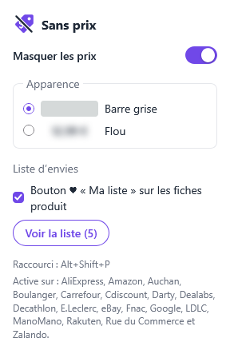

# Sans prix

Extension Firefox qui **masque les prix sur les grandes boutiques en ligne** —
Amazon, Fnac, Cdiscount, Darty, Boulanger, LDLC, E.Leclerc, Carrefour, Auchan,
eBay, AliExpress, Zalando… — et sur **Google** (produits sponsorisés de la
recherche et de Google Images), pour laisser un enfant parcourir des idées de
cadeaux sans lui donner la notion de prix.

## Pourquoi

À l'approche de Noël ou d'un anniversaire, le plus sûr moyen de savoir ce qui
ferait plaisir à un enfant, c'est de le laisser parcourir les boutiques en
ligne et de le regarder faire : ce qu'il ouvre, ce sur quoi il s'attarde, ce
qu'il montre du doigt. Mais les prix sont partout, et ils changent la
conversation :

- l'enfant **se censure** (« celui-là, c'est trop cher ») ou, à l'inverse, vise
  le plus cher en le croyant le meilleur ;
- il **compare** : « mon frère a eu un cadeau à 80 €, moi à 30 € » ;
- le **budget**, qui est l'affaire des parents, devient un sujet de discussion.

Sans les prix, il choisit sur ce que l'objet est — photos, description, avis —
et la question du montant reste entre adultes. Une fois l'enfant parti,
<kbd>Alt</kbd>+<kbd>Maj</kbd>+<kbd>P</kbd> fait revenir les prix pour faire les
comptes.

Le masquage s'applique **avant** que la page ne s'affiche : aucun prix ne
clignote au chargement, pas même une fraction de seconde. Seules les remises en
pourcentage (« -50 % ») restent visibles — voir
[Ce qui est masqué](#ce-qui-est-masqué).

Le même principe sert à qui veut comparer des produits sans se laisser guider
par leur prix.

## En pratique

Les prix sont remplacés par une **barre grise** (ou **floutés**, au choix). Un
interrupteur dans le popup, ou <kbd>Alt</kbd>+<kbd>Maj</kbd>+<kbd>P</kbd>, les
fait revenir dans tous les onglets à la fois ; une pastille « off » sur l'icône
rappelle qu'ils sont visibles.



_Extension indépendante : ni éditée ni approuvée par les sites qu'elle couvre._

## La liste d'envies

Sur une fiche produit, un bouton **♥ Ma liste** permet à l'enfant de marquer ce
qui lui plaît, sans jamais y voir de prix. Le parent retrouve la liste depuis le
popup (**Voir la liste**) : image, titre, boutique, lien vers la fiche.

Les prix y sont **masqués à l'ouverture**, comme sur les boutiques : l'enfant
peut ouvrir la liste sans rien dévoiler. **Afficher les prix** les montre, avec
le **total** par devise, le temps de la visite. **Partager la liste** passe par
le partage du système sur Android, par le presse-papiers ailleurs, et reprend ce
qui est à l'écran : sans les prix tant qu'ils sont masqués.


L'extension reconnaît une fiche à ses données structurées — JSON-LD
`Product`, microdonnées, Open Graph — que la plupart des boutiques publient pour
les moteurs de recherche ; pour Amazon et Rue du Commerce, qui n'en publient
pas, la règle du site indique où lire titre, prix et image (`fiche`). Le bouton
se désactive dans le popup.

## Installer

Firefox 140 ou plus récent.

| Façon                              | Durée                  | Ce qu'il faut                                                                                                                                                                      |
| ---------------------------------- | ---------------------- | ---------------------------------------------------------------------------------------------------------------------------------------------------------------------------------- |
| **Temporaire**                     | jusqu'au redémarrage   | `about:debugging#/runtime/this-firefox` → _Charger un module complémentaire temporaire…_ → choisir `extension/manifest.json`                                                       |
| **Essai en un geste**              | le temps de la session | `npm install` puis `npm start` : ouvre Firefox sur amazon.fr, extension chargée, rechargée à chaque modification                                                                  |
| **Permanente, pour soi**           | définitive             | signer sans publier : clés d'API sur [addons.mozilla.org](https://addons.mozilla.org/developers/addon/api/key/), puis `npx web-ext sign --channel unlisted --source-dir extension` |
| **Permanente, pour tout le monde** | définitive             | publier sur addons.mozilla.org (`--channel listed`), après relecture par Mozilla                                                                                                  |

Firefox refuse d'installer durablement une extension non signée, sauf dans
Developer Edition ou Nightly avec `xpinstall.signatures.required` à `false`.

### Sur Android

Firefox pour Android 142 ou plus récent. Le masquage, le popup (menu **⋮ →
Extensions → Sans prix**) et la liste d'envies y fonctionnent ; le popup s'y
ouvre en plein écran, avec des cibles à la taille du doigt. Il n'y a pas de
raccourci clavier : l'interrupteur du popup le remplace.

Installer une extension qui n'est pas publiée sur addons.mozilla.org demande le
`.xpi` **signé** et le menu de débogage : **Paramètres → À propos de Firefox**,
toucher cinq fois le logo, puis **Paramètres → Installer une extension depuis un
fichier**. Pour essayer depuis un poste de développement, téléphone branché en
USB et débogage USB activé :

```bash
npx web-ext run --source-dir extension -t firefox-android --android-device <identifiant adb>
```

### Déployer à la main : le paquet

`npm run paquet` prépare, dans `web-ext-artifacts/mister-no-price-<version>/`,
de quoi installer l'extension sur un poste sans rien savoir de ce dépôt :

| Fichier                          | Rôle                                                                     |
| -------------------------------- | ------------------------------------------------------------------------ |
| `mister-no-price-<version>.xpi`  | l'extension signée par Mozilla — seulement avec des clés d'API (ci-dessous) |
| `mister-no-price-<version>.zip`  | l'extension non signée                                                   |
| `INSTALLER.md`                   | les façons d'installer, pas à pas, pour qui n'est pas développeur        |
| `policies.json`                  | stratégie Firefox qui **impose** l'extension sur un ordinateur familial  |
| `SHA256SUMS`                     | empreintes, pour `sha256sum -c`                                          |

Le guide et la stratégie viennent de [`deploiement/`](deploiement/), remplis à
la version et à l'identifiant du manifeste.

La signature passe par le canal _unlisted_ d'addons.mozilla.org : Mozilla signe
sans publier, en quelques minutes. Il faut des clés d'API
([page des clés](https://addons.mozilla.org/developers/addon/api/key/)) dans
`WEB_EXT_API_KEY` et `WEB_EXT_API_SECRET` ; sans elles, le paquet sort sans
`.xpi` et le dit. Mozilla ne signe qu'une fois un numéro de version.

**Par la CI** : pousser une étiquette `v<version>` (celle du manifeste) lance
[`publication.yml`](.github/workflows/publication.yml), qui teste, construit le
paquet et ouvre un **brouillon** de release GitHub où il est joint, en archive
et fichier par fichier. Le publier reste un geste à la main. La signature y
demande les secrets `AMO_API_KEY` et `AMO_API_SECRET` du dépôt.

```bash
git tag v1.2.1 && git push origin v1.2.1
```

### Après une mise à jour : un « ! » sur l'icône

Firefox accorde les accès d'une extension **à son installation**, pas ceux
qu'une mise à jour ajoute. Une version qui gagne des sites n'y agit donc pas
tant qu'on n'a pas dit oui. Un clic sur l'icône la lance pour la page ouverte,
mais les prix réapparaissent à la page suivante.

L'icône porte alors une pastille **« ! »**. Ouvrir le popup : un encart nomme
les sites concernés ; **« Autoriser »** les accorde tous, une fois pour toutes.
Le même réglage existe site par site dans le menu des extensions de Firefox
(l'icône en forme de pièce de puzzle).

## Ce qui est masqué

| Site                | Domaines couverts                    | Prix masqués (bureau)                                   | Bouton ♥               | Site mobile         |
| ------------------- | ------------------------------------ | ------------------------------------------------------- | ---------------------- | ------------------- |
| **Amazon**          | 23 boutiques                         | ✔ amazon.fr, .com, .co.uk, .de, .es, .it                | ✔ les six              | ✔ amazon.fr, .com   |
| **AliExpress**      | aliexpress.com                       | ✔                                                       | ✔                      | non vérifié (délai) |
| **Auchan**          | auchan.fr                            | ✔                                                       | ✔                      | ✔                   |
| **Boulanger**       | boulanger.com                        | ✔                                                       | ✔                      | ✔                   |
| **Cdiscount**       | cdiscount.com                        | ✔                                                       | ✔                      | ✔                   |
| **Dealabs**         | dealabs.com                          | ✔                                                       | — pas de fiche produit | ✔                   |
| **Decathlon**       | 11 pays                              | ✔ decathlon.fr                                          | ✔                      | ✔                   |
| **E.Leclerc**       | e.leclerc, leclerc.fr                | ✔                                                       | ✔                      | ✔                   |
| **eBay**            | ebay.fr, ebay.com                    | ✔ les deux                                              | ✔ les deux             | ✔ ebay.fr           |
| **LDLC**            | ldlc.com                             | ✔                                                       | ✔                      | ✔                   |
| **Rue du Commerce** | rueducommerce.fr                     | ✔                                                       | ✔                      | ✔                   |
| **Zalando**         | zalando.fr                           | ✔ (générique seul)                                      | ✔                      | ✔                   |
| **Fnac**            | fnac.com                             | ✘ anti-robot ; règle tirée de la liste, vue une fois    | règle non vérifiée     | ✘ anti-robot        |
| **Darty**           | darty.com                            | ✘ anti-robot ; générique seul                           | ✘                      | ✘                   |
| **Carrefour**       | carrefour.fr                         | ✘ anti-robot ; générique seul                           | ✘                      | ✘                   |
| **ManoMano**        | manomano.fr                          | ✘ anti-robot ; générique seul                           | ✘                      | ✘                   |
| **Rakuten**         | rakuten.com                          | — la place de marché française a fermé ; générique seul | —                      | —                   |
| **Google**          | www.google.fr, .com, .be, .ch, … (9) | ◐ recherche et Images, voir ci-dessous                  | — pas de fiche produit | ✘ anti-robot        |

« ✔ » : `npm run verifier` a visité une liste et une fiche produit et n'y a
trouvé aucun montant lisible ; « Bouton ♥ » : il a ajouté la fiche à la liste
d'envies, qui l'affiche avec titre, image et prix ; « Site mobile » : les mêmes
vérifications avec `MOBILE=1`, en se présentant comme Firefox pour Android. Les autres domaines d'Amazon et de Decathlon
partagent le balisage du site vérifié, sans l'avoir été eux-mêmes.

« ◐ » Google : la recherche et Google Images répondent au Firefox piloté par
leur page anti-robot (`/sorry`). Les scripts de l'extension ont été rejoués sur
les vraies pages dans un autre navigateur (Chromium), réglages simulés : aucun
montant lisible, produits sponsorisés compris (« Avant : ▬ », « + ▬ de
frais »). C'est le même code, sur le même balisage ; ce n'est pas Firefox.

Sur Google, la règle porte sur des **hôtes exacts** (`www.google.fr`…) et non
sur le domaine : `*.google.com` ferait tourner l'extension dans Gmail, Docs ou
Drive. Elle masque les montants de **toute** la page de résultats, pas
seulement du bloc sponsorisé : fiches Shopping, extraits, aperçu IA (« moins
de ▬ »).

« ✘ anti-robot » : ces sites répondent à un navigateur piloté par une
vérification anti-robot, que le script ne contourne pas. Leur balisage n'a pas
pu être relevé ; l'extension y applique les mécanismes génériques ci-dessous,
qui ne dépendent d'aucun sélecteur, mais leur résultat n'a pas été vu. Les
vérifier demande de passer soi-même la vérification (`VISIBLE=1`).

Partout :

- les composants de prix du site, prix barrés compris (« Prix conseillé »,
  « Prix le plus bas sur 30 jours ») ;
- tout montant écrit en clair : « 3 neufs à partir de 12,99 € », « Livraison
  gratuite dès 35 € », « de 10 à 20 EUR », titres des bons plans Dealabs… ;
- les prix **éclatés** en morceaux (« 34 » « €99 ») ;
- le **titre de l'onglet** : « Robot X60 999€ chez Boulanger » devient « Robot
  X60 ••• chez Boulanger », et retrouve son prix quand on suspend le masquage.

Les montants sont reconnus en euros, dollars, livres, yens, roupies, zlotys,
couronnes, livres turques et codes ISO (`EUR 12,99`, `AED 49.00`).

**Restent visibles, volontairement** : les remises en pourcentage (« -50 % »),
les notes, les nombres d'avis et les stocks. On masque des montants, pas les
promotions ; et un nombre sans devise n'est jamais pris pour un prix.

## Comment ça marche

Un **moteur de règles** : chaque site est décrit par une règle de quelques
lignes ([`regles.js`](extension/regles.js)) ; tout le reste est générique.

```js
{
  id: "decathlon",
  nom: "Decathlon",
  domaines: ["decathlon.fr", "decathlon.be", /* … */],
  masquer: [".vp-price-amount", ".vp-price-barred-amount", /* … */],
}
```

Sur une page, [`masquage.js`](extension/content/masquage.js) applique quatre
mécanismes :

1. **La feuille du site.** Le moteur ([`moteur.js`](extension/content/moteur.js))
   tire des sélecteurs `masquer` une feuille de style, posée dès
   `document_start` : les composants de prix connus sont couverts avant le
   premier affichage. Elle **échoue fermée** : le masquage vaut tant que la page
   ne porte pas `data-sans-prix="off"`, que le script ne pose qu'après avoir lu
   les réglages.
2. **Les montants dans le texte** ([`detection.js`](extension/content/detection.js)),
   recouverts par l'[API CSS Custom
   Highlight](https://developer.mozilla.org/fr/docs/Web/API/CSS_Custom_Highlight_API) :
   aucune balise ajoutée, aucun nœud découpé. Ces sites rendent leurs pages
   avec React ou Vue, qui gardent la main sur leurs nœuds texte — les envelopper
   dans un `<span>` casserait leurs mises à jour.
3. **Les prix éclatés.** Un nœud qui n'est qu'un morceau (« 34 », « €99 »)
   fait remonter à l'ancêtre proche (trois niveaux, 30 caractères au plus) qui
   forme un montant **et** apporte d'autres chiffres ; cet ancêtre reçoit un
   attribut que la feuille couvre. Comparer les chiffres plutôt que le texte
   laisse « Prix : 12,99 € » tranquille : le libellé n'ajoute aucun chiffre.
4. **Le titre de l'onglet**, dont les montants sont remplacés, puis rendus.

Un `MutationObserver` suit les carrousels, le défilement infini, les pages qui
se réhydratent — et repose les attributs de réglage sur `<html>` quand une
application les efface (Decathlon le fait).

### Ajouter un site

1. Écrire sa règle dans [`regles.js`](extension/regles.js) : des `domaines`
   (sous-domaines compris) ou des `hotes` exacts, quand le domaine entier
   serait trop large. `masquer` ne retient que des éléments qui ne contiennent
   **que** des prix ; le reste, le générique s'en charge. Un sélecteur invalide
   est ignoré sans emporter les autres.
2. Ajouter ses motifs aux `matches` du [manifeste](extension/manifest.json) —
   `npm test` refuse un écart entre les deux listes.
3. Ajouter une page de liste et un lien de fiche (ou des adresses fixes,
   `urls`) dans `PAGES` de [`scripts/pages.mjs`](scripts/pages.mjs), puis
   `SITES=<domaine> npm run verifier` jusqu'à n'avoir plus aucun montant
   lisible, et un bouton ♥ sur la fiche. S'il manque, le site ne publie pas de
   données structurées : donner à sa règle une `fiche` (sélecteurs du titre, du
   prix, de l'image).

## Confidentialité

L'extension ne collecte, n'envoie ni ne lit rien d'autre que les pages des sites
qu'elle masque. Aucune requête réseau de son fait. Elle conserve trois réglages
(`actif`, `style`, `envies`) dans `storage.sync`, qui suivent le compte Firefox
s'il est synchronisé, et la liste d'envies dans `storage.local`, sur l'appareil
seulement. Le manifeste le déclare (`data_collection_permissions: none`).

La page de la liste affiche les images des articles depuis les serveurs des
boutiques, sans en-tête `Referer` : la boutique voit qu'une de ses images est
chargée, comme lors de la visite de la fiche.

## Limites connues

- Un prix dessiné dans une **image** (bannière, vignette d'un bon plan) reste
  visible.
- Une publicité servie dans un cadre d'un **autre domaine**
  (`amazon-adsystem.com`…) n'est pas couverte : l'extension ne demande l'accès
  qu'aux sites de ses règles.
- Ces sites changent leur balisage sans prévenir. Un nouveau composant de prix
  que ni la règle ni le générique ne reconnaissent passera — c'est ce que
  `npm run verifier` détecte.
- Un nombre **sans devise** n'est jamais pris pour un prix : les bornes d'un
  curseur de filtre « Prix (en €) : 4 – 1549 » (LDLC) restent lisibles.
- Quatre sites (Fnac, Darty, Carrefour, ManoMano) n'ont pas pu être vérifiés,
  et Google seulement hors de Firefox : voir le tableau ci-dessus.
- Le bouton ♥ n'apparaît que sur une fiche reconnue : pas sur Dealabs, dont
  les pages sont des discussions et non des produits, ni sur Google. Le prix
  retenu est celui de la fiche au moment du clic, pour la variante affichée.
- Firefox pour Android n'a été essayé qu'en se faisant passer pour lui
  (`MOBILE=1`) : balisage mobile des boutiques, mise en page au doigt. Les API
  propres au téléphone ne l'ont été que par les tests (`browser.commands`
  absente).
- La feuille d'un site est posée dans un `<style>` ; une politique de sécurité
  (CSP) qui interdirait les styles en ligne la bloquerait. Aucun des sites
  vérifiés ne le fait ; le repérage dans le texte, lui, n'en dépend pas.

## Développer

```bash
npm install
```

```bash
npm test          # repérage des montants, moteur, règles, accord manifeste-règles
```

```bash
npm run lint      # validation du manifeste par web-ext (outil de Mozilla)
```

```bash
npm run verifier  # les vrais sites, dans le Firefox du poste
```

```bash
MOBILE=1 npm run verifier  # les mêmes, en se présentant comme Firefox pour Android
```

```bash
npm run verifier:mise-a-jour  # installe la 1.0.0, met à jour, accorde les accès
```

```bash
npm run build     # l'extension seule, en .zip, dans web-ext-artifacts/
```

```bash
npm run paquet    # le paquet de déploiement (voir « Déployer à la main »)
```

La CI ([`ci.yml`](.github/workflows/ci.yml)) joue les tests, `web-ext lint`
(qui y échoue sur un avertissement) et l'empaquetage, sur chaque PR et sur
`main` ; une seconde garde refuse les signatures d'assistant dans les commits et
les fichiers. Les deux sont exigées pour fusionner. `npm run verifier`, qui
dépend des vrais sites, se lance à la main.

`npm run verifier` lance Firefox sur un profil jetable, extension installée, et
visite pour chaque site une liste puis une fiche produit. Il **relève chaque
montant encore lisible** — ni sous une barre, ni flouté, ni hors écran, titre de
l'onglet compris —, refuse au passage les bandeaux de cookies, puis bascule
l'interrupteur et l'apparence depuis le popup et vérifie que la page suit. Sur
chaque fiche, il actionne le bouton ♥ ; à la fin, il ouvre la liste d'envies et
vérifie que chaque article y est, prix masqués puis visibles à la demande.
Captures dans `captures/` (`captures/mobile/` avec `MOBILE=1`, qui se présente
comme Firefox pour Android : agent utilisateur, écran de téléphone, pointeur
« coarse »). Variables : `SITES` (`amazon.fr,cdiscount.com`…),
`FIREFOX` (chemin de l'exécutable), `VISIBLE=1` pour voir la fenêtre.

Pour ouvrir le popup, le script passe par la fenêtre de Firefox elle-même
(`MOZ_REMOTE_ALLOW_SYSTEM_ACCESS`, sur le seul profil jetable) : WebDriver BiDi
refuse de naviguer vers une adresse `moz-extension://`. Un site qui répond par
une vérification anti-robot est noté « non vérifié », sans contournement ;
`VISIBLE=1` permet de la passer soi-même.

```
extension/
├── manifest.json          MV3, Firefox 140+
├── regles.js              une règle par site : domaines, sélecteurs
├── background.js          raccourci clavier, pastille « off » sur l'icône
├── commun/reglages.js     réglages partagés (storage.sync)
├── commun/envies.js       la liste d'envies (storage.local)
├── commun/acces.js        accès aux sites qu'une mise à jour a ajoutés
├── content/
│   ├── moteur.js          choisir la règle, en tirer la feuille (fonctions pures)
│   ├── detection.js       repérage des montants dans un texte
│   ├── masquage.js        feuille, surlignage, prix éclatés, titre, réglages
│   ├── masquage.css       peinture des montants surlignés
│   ├── produit.js         reconnaître une fiche produit (fonctions pures)
│   └── envies.js          le bouton ♥ « Ma liste »
├── popup/                 interrupteur, apparence, liste d'envies, sites
├── liste/                 la page de la liste d'envies
├── icons/icone.svg
└── _locales/              fr (par défaut), en
```

## Licence

[MIT](LICENSE)
